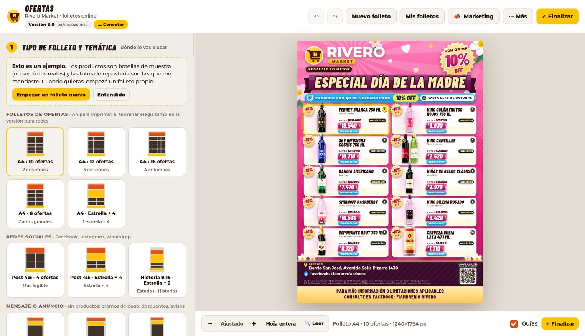
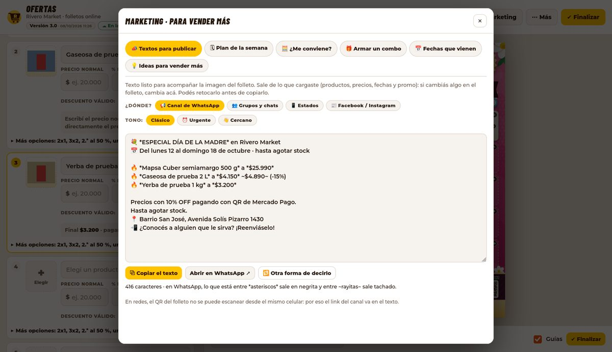

# Rivero Market · Folletos de ofertas

Herramienta para armar los folletos de ofertas de **Rivero Market**: A4 para imprimir, publicaciones de Facebook e Instagram, Estados y canal de WhatsApp. Vos cambiás producto, precio y fechas; el logo, la dirección, el QR del canal y la leyenda legal ya están puestos.

## 👉 Usarla online

**https://mickyrivero90-ai.github.io/Market-Rivero/**

- Anda en la PC de casa, en la del negocio y en el celular, sin instalar nada.
- **Siempre está actualizada.** Cada cambio que se sube a este repositorio se publica solo en uno o dos minutos. Si la tenés abierta cuando sale una versión nueva, aparece un aviso arriba con el botón «Actualizar ahora».
- **Lo mismo en todas las computadoras.** Las fotos de productos, los precios recordados y «Mis folletos» se guardan acá, en GitHub. Si empezás un folleto en una PC, en la otra te pregunta «¿Seguís con el folleto de la otra computadora?».



### La primera vez en cada computadora: conectar con GitHub (2 minutos)

Para **mirar** y armar folletos no hace falta nada. Para **guardar** (subir fotos, recordar precios, «Mis folletos») la página necesita una llave de tu cuenta de GitHub, que se crea una sola vez en cada computadora:

1. Abrí la herramienta y tocá **☁ Conectar** (arriba a la izquierda).
2. Escribí cómo se llama esa computadora (Casa, Negocio…) y tocá **Abrir GitHub para crear la llave**. El nombre de la llave y el permiso ya vienen puestos.
3. En GitHub, en **Repository access**, elegí **Only select repositories** y marcá **Market-Rivero**. Abajo de todo, **Generate token**, y copiá la llave (empieza con `github_pat_`).
4. Pegala en la herramienta y tocá **Conectar**. Listo: el botón pasa a decir **☁ En la nube**.

La llave queda guardada solo en ese navegador y solo sirve para este repositorio. Si alguna vez querés anularla, se borra en GitHub: *Settings → Developer settings → Personal access tokens*.

### Traer las fotos de la PC del negocio

En la PC del negocio, abrí la herramienta online, conectá la llave y tocá **⋯ Más → ⇪ Traer lo de esta PC**. Elegí la carpeta del programa viejo (por ejemplo `Rivero-Market-Folletos`, en el Escritorio o en Descargas). Sube a la nube las **fotos de productos**, los **precios recordados** y **«Mis folletos»** que todavía no estén. No borra ni cambia nada en esa computadora, y si lo hacés dos veces no repite nada.

También sirve para subir de una vez una carpeta con fotos nuevas: cada subcarpeta es una categoría.

### Fotos nuevas, sin fondo

Sacá las fotos de tus productos como quieras (con el celular, sobre cualquier fondo), tocá **✂ Fotos nuevas** y poneles nombre. **GitHub les quita el fondo con IA** (la misma que usaba el programa de la PC) y en 1 a 3 minutos aparecen recortadas en el buscador, en cualquier computadora. Las fotos que ya vienen sin fondo se suben tal cual.

En un producto que ya está en el folleto, **Más opciones → Quitar fondo con IA** hace lo mismo y la foto se cambia sola en el folleto cuando está lista.

### Al terminar un folleto

**✔ Finalizar** genera las imágenes para cada destino (A4 + PDF, Facebook, canal de WhatsApp, Estados, un producto por imagen…):

- En **Chrome o Edge** podés elegir una carpeta de la PC (por ejemplo el Escritorio) y quedan guardadas ahí, como en el programa viejo.
- En los demás navegadores se descargan: si son varias imágenes, juntas en un `.zip`.
- En el celular aparece **Compartir**, para mandarlas directo a WhatsApp o Facebook.
- Queda una copia en **«Mis folletos»** (en la nube) y los precios se recuerdan para la próxima vez.

## 📣 Marketing: para vender más

Botón **📣 Marketing** (arriba) o sección **«Para vender más»** del panel:

| Herramienta | Para qué sirve |
|---|---|
| **Textos para publicar** | El texto para acompañar la imagen, armado con tus productos, precios, fechas y promo: canal de WhatsApp, grupos y chats, Estados (uno por producto) y Facebook/Instagram (con hashtags). Tres tonos: clásico, urgente («¡Quedan 2 días!») y cercano («¡Hola, vecinos!»). Copiar o abrir directo en WhatsApp. |
| **Plan de la semana** | Qué publicar, dónde y a qué hora, día por día, con el texto listo y casillas para tildar. Se puede bajar como **recordatorios para el celular** (archivo `.ics` para el calendario). |
| **¿Me conviene?** | Con el costo del producto: cuánto ganás con y sin oferta, y **cuánto más tenés que vender** para ganar lo mismo. Precio de venta desde el costo (con la diferencia entre lo que le sumás y lo que te queda). El costo queda solo en tu computadora. |
| **Armar un combo** | Elegís productos del folleto, ponés el precio del combo y lo agrega como un producto más, con las fotos juntas y la insignia «COMBO». |
| **Fechas que vienen** | Calendario comercial argentino (Día de la Madre, Halloween, Black Friday, Navidad, aguinaldo, fechas patrias…) con cuándo empezar a publicar e ideas de productos. «Usar esta fecha» pone el fondo y la vigencia. |
| **Ideas para vender más** | Guía práctica para un comercio de barrio: Perfil de Empresa en Google, WhatsApp Business, crecer el canal, Estados, Facebook, el local, precios y promos, fidelizar y medir. Con casillas para ir marcando lo que ya hacés. |



## Ejemplos

 

*(Las botellas de los ejemplos son dibujos genéricos hechos en Blender, no fotos de productos reales.)*

## Programa para usar sin internet

Sigue existiendo el programa que corre en la PC (sin internet, guarda en el Escritorio y quita el fondo con IA en Linux). Se descarga siempre actualizado desde la herramienta online: **⋯ Más → Programa para usar sin internet**, o en [descargas/Rivero-Market-Folletos.zip](https://mickyrivero90-ai.github.io/Market-Rivero/descargas/Rivero-Market-Folletos.zip). Necesita Python 3 (en Windows, gratis en python.org: al instalar, tildar «Add python.exe to PATH»). Instrucciones en `LEEME.txt`.

## Privacidad

Este repositorio es **público**: cualquiera que lo encuentre puede ver las fotos de productos, los precios recordados y los folletos guardados (son los mismos que se publican en redes). El **costo** de los productos (calculadora) y la **llave** de GitHub quedan solo en el navegador de cada computadora y nunca se suben. Si en algún momento preferís que sea privado, se puede, pero GitHub Pages en repositorios privados necesita un plan pago (o pasar la página a otro servicio gratuito).

Lo legal que marca la herramienta (fechas, stock, banda al pie, precios, alcohol) es una guía armada con normas oficiales; no reemplaza el consejo de un contador o abogado.

---

## Cómo está armado (para quien lo mantenga)

| Carpeta | Qué hay |
|---|---|
| `editor/` | La herramienta: `src/*.js` (motor de dibujo, pantalla, nube, marketing), `styles.css`, fuentes, `build.py` (la junta en un solo HTML) y `empaquetar.py` (el ZIP del programa). |
| `programa/` | El programa local: `servidor.py` (solo escucha en 127.0.0.1), `recortar.py` (quita el fondo con IA). |
| `productos/` | **Las fotos de productos** (la carpeta compartida). El nombre del archivo es el nombre del producto; cada subcarpeta es una categoría. `productos/_entrada/` son fotos esperando que GitHub les quite el fondo. |
| `datos/` | Lo que guarda la herramienta online: `catalogo.json` (precios recordados), `proyectos/` («Mis folletos»), `borradores/` (el folleto en curso de cada PC). |
| `herramientas/` | `armar_sitio.py` (arma la página para GitHub Pages: herramienta, catálogo con miniaturas, versión, ZIP), `procesar_entrada.py` (quita el fondo en GitHub Actions), `pruebas/`. |
| `.github/workflows/publicar.yml` | Con cada cambio: quita el fondo de las fotos nuevas, arma la página y la publica en GitHub Pages. Los cambios de `datos/` no hace falta publicarlos (la herramienta los lee directo del repositorio). |
| `logo/`, `assets/`, `blender/` | Marca, recursos incrustados y scripts de las botellas de ejemplo. |

**Cómo funciona la nube.** La página es estática (GitHub Pages). Lee la lista de archivos con la API de GitHub (con ETag, así casi no gasta consultas) y las fotos desde `raw.githubusercontent.com`. Para guardar usa la API de git (blobs, árboles y commits; si otra PC guardó en el medio, vuelve a intentar y junta los cambios) y la de contenidos. Lo que no se puede guardar en la nube (folleto en curso de cada navegador, llave, costos) queda en el navegador (IndexedDB y localStorage).

**Versiones.** Cambiar el número en `editor/VERSION`, anotar los cambios en `CAMBIOS.txt` y subir: GitHub Actions publica solo. El historial completo del proyecto está en `CONTEXTO_DEL_PROYECTO.txt`.

**Pruebas** (en la PC de desarrollo, con Python + Selenium + Firefox + geckodriver):

```bash
python3 herramientas/armar_sitio.py --salida /tmp/sitio --pruebas --repo prueba/tienda   # armar la página
python  herramientas/pruebas/prueba_nube.py    # la versión online de punta a punta, con un GitHub de mentira
python  herramientas/procesar_entrada.py --raiz CARPETA_DE_PRUEBA                       # el recorte con IA (necesita rembg)
```

Licencia: AGPL-3.0 (ver `LICENSE`).
